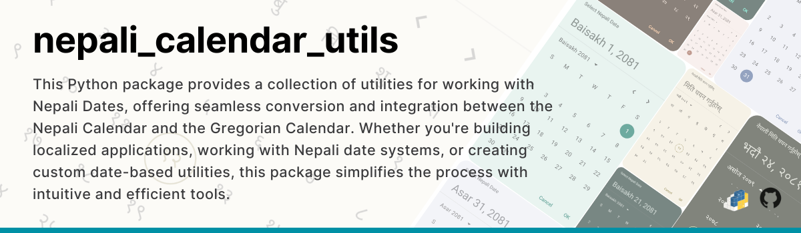

# Nepali Calendar Utilities
<p align="center">
  
</p>

This Python package provides a collection of utilities for working with Nepali Dates, offering seamless conversion and integration between the Nepali Calendar and the Gregorian Calendar. Whether you're building localized applications, working with Nepali date systems, or creating custom date-based utilities, this package simplifies the process with intuitive and efficient tools.

<br>

<p align="center">
  <a href="https://pypi.org/project/nepali_calendar_utils/">
    </a>&nbsp;
  <a href="https://github.com/shivathapaa/nepali_calendar_utils/blob/main/LICENSE">
    </a>&nbsp;
  <a href="https://shivathapaa.github.io/nepali_calendar_utils/">
    </a>&nbsp;
  <a href="https://www.npmjs.com/package/@nepali-date-picker/web-component">
    </a>
</p>

<br>

## Need a date picker UI, or another language?

This package is the **Python** port of the [Nepali Date Picker](https://github.com/shivathapaa/Nepali-Date-Picker)
calendar core. The same tables are ported to Kotlin, Swift and JavaScript, so conversions match
across all four, and every platform ships a ready-made picker UI that this package deliberately does
not:

| Platform | Guide | Packages |
| --- | --- | --- |
| **Python / backend** | This README | [PyPI](https://pypi.org/project/nepali_calendar_utils/) |
| **Kotlin / Android / KMP** | [main README](https://github.com/shivathapaa/Nepali-Date-Picker/blob/main/README.md) | `io.github.shivathapaa:nepali-date-picker-ui` (Material3 pickers) and `:nepali-date-picker-core` (engine only) on [Maven Central](https://central.sonatype.com/namespace/io.github.shivathapaa) |
| **Swift / iOS** | [README-spm.md](https://github.com/shivathapaa/Nepali-Date-Picker/blob/main/README-spm.md) | [Nepali-Date-Picker-SPM](https://github.com/shivathapaa/Nepali-Date-Picker-SPM) |
| **JavaScript / TypeScript / web** | [README-js.md](https://github.com/shivathapaa/Nepali-Date-Picker/blob/main/README-js.md) | [`@nepali-date-picker/web-component`](https://www.npmjs.com/package/@nepali-date-picker/web-component) (framework-agnostic elements) and [`@nepali-date-picker/core`](https://www.npmjs.com/package/@nepali-date-picker/core) (engine only, the JS counterpart of this package) |

Live: the [Compose demo](https://shivathapaa.github.io/Nepali-Date-Picker/) and the
[web-component demo](https://shivathapaa.github.io/Nepali-Date-Picker/demo/).

<br>

<details>
  <summary><b>Table of Contents</b></summary>

* [Need a date picker UI, or another language?](#need-a-date-picker-ui-or-another-language)
* [Types/features](#typesfeatures)
* [Installation](#installation)
* [Documentation](#documentation)
* [How to use in your project](#how-to-use-in-your-project)
* [Utilities to explore](#utilities-to-explore)
* [Support](#support)
* [License](#license)
</details>

## Types/Features

This package provides variety of features for working with Nepali calendar dates. It is not only limited to date conversion but many utilities that serves its purpose with extended support for date and time.

Few of them are listed below:

- `CustomCalendar` - Calendar which represents both English and Nepali dates.
- `SimpleDate` and  `SimpleTime` - Simple representation of date and time.
- `NepaliMonthCalendar` - Nepali Month Calendar which consists of the month details.
- `MonthCalendar` and `CalendarSystem` - A month of either calendar, tagged with the system it belongs to (`BIKRAM_SAMBAT` era 2, `GREGORIAN` era 1), so layout code need not know which one produced it.
- `NepaliDateLocale` - To control language, dateFormat, weekDayName, and monthName.
- `NepaliCalendarUtilsLang` - Set of supported language (English & Nepali for now).
- `NepaliDateConverter` - Provides utilities for date conversions (english to nepali and vice versa), get formatted date(6), get time, get date-time in ISO 8601 format, calculate days in between two date, and many more.
- `DigitScript` - Numeral script (`LATIN` / `DEVANAGARI`) decoupled from language, with digit localization helpers.
- `NepaliDateFormatter` - Parse and format `SimpleDate` for short numeric text-field input (`YYYY/MM/DD` and friends).
- `NepaliTimeFormatter` - Parse and format `SimpleTime` as `HH:mm:ss` with an optional nine-digit fractional part, the shape a time takes on the wire.
- `NepaliSelectableDates` - Predicate for enabling/disabling dates, with before/after/range factories.
- Calendar-event SPI (`NepaliEventProvider`, `NepaliCalendarEvent`, `NepaliEventKind`, `NepaliWeekend`) with multi-day spans, and working-day arithmetic (`working_days_between`, `next_working_day`, `add_working_days`).
- `NepaliCalendarPolicy` and `NepaliDayStatus` - the week an institution keeps plus the events it names, answering for one day or a whole month.

> **New in 3.1.0:** a holiday is now one kind of calendar event. `NepaliCalendarEvent` says whether a day is worked through `closes_offices` rather than leaving it to the category, `NepaliCalendarPolicy` states a week and an event list together and answers `status_of`, `month_status` and the working-day helpers from both, and `spanning_days` / `spanning_through` expand a festival or a leave that runs longer than a day. The 3.0.0 holiday names keep working. See the [release notes](https://github.com/shivathapaa/nepali_calendar_utils/releases).


## Talking to a Kotlin, Android, Swift or JavaScript client

This package is a port of the `:core` module of the sibling
[Nepali-Date-Picker](https://github.com/shivathapaa/Nepali-Date-Picker) project, so a payload
written here reads on any of its platforms. The conversion tables, every conversion result, and
the wire strings below are verified identical between the two.

The Kotlin side has an optional `kotlinx-serialization` artifact that defines these shapes. There
is no Python counterpart and none is needed: dataclasses and `json` produce the same bytes.

| Type | On the wire | Produce it here with |
| --- | --- | --- |
| `SimpleDate` | `"2082-02-14"` | `NepaliDateFormatter.format(date, DatePattern.YYYY_DASH_MM_DASH_DD)` |
| `SimpleDate` (struct form) | `{"year": 2082, "month": 2, "dayOfMonth": 14}` | `dataclasses.asdict`, renaming `day_of_month` |
| `SimpleTime` | `"09:30:00"`, `"23:59:59.123456789"` | `NepaliTimeFormatter.format(time)` |
| `CustomCalendar` | 12-field object: `year`, `month`, `dayOfMonth`, `era`, `firstDayOfMonth`, `lastDayOfMonth`, `totalDaysInMonth`, `dayOfWeekInMonth`, `dayOfWeek`, `dayOfYear`, `weekOfMonth`, `weekOfYear` | `dataclasses.asdict`, camel-casing the keys |
| `CalendarSystem` | `1` for Gregorian, `2` for Bikram Sambat | `system.era` |
| `NepaliCalendarEvent` | `{"date": "2082-01-01", "name": "...", "kind": "GovernmentPublic"}`, plus `closesOffices`, `id` and `payload` when set | see the note below |
| `NepaliDayStatus` | `{"isWeeklyOff": false, "events": [...]}` | - |

The last five `CustomCalendar` fields are optional going back into Kotlin and default to `-1`, so
a payload that omits them still decodes. When all you mean is a day, send the `SimpleDate` string
rather than a whole calendar record.

**Field names differ by convention.** This package is snake_case and the others are camelCase, so
`day_of_month` travels as `dayOfMonth`. Convert at the boundary; nothing in the values changes.

**`kind` needs translating.** Kotlin writes the enum's own name, `GovernmentPublic`, `Religious`,
`Regional`, `Observance`. This package spells the same members `GOVERNMENT_PUBLIC`, `RELIGIOUS`,
`REGIONAL`, `OBSERVANCE`, and the Swift and JavaScript APIs use `governmentPublic`. Kotlin rejects
a name it does not know rather than guessing, since the guess would decide whether a day closes an
office:

```python
_TO_WIRE = {
    NepaliEventKind.GOVERNMENT_PUBLIC: "GovernmentPublic",
    NepaliEventKind.RELIGIOUS: "Religious",
    NepaliEventKind.REGIONAL: "Regional",
    NepaliEventKind.OBSERVANCE: "Observance",
}
_FROM_WIRE = {wire: kind for kind, wire in _TO_WIRE.items()}
```

**A span is many entries.** A Kotlin event covers exactly one day, so something that runs longer
travels as one entry per day sharing an `id`. `spanning_days` and `spanning_through` already build
that shape; collapse it back with `id` on the way in.


## Installation

Requires **Python 3.11+**. No third-party runtime dependencies (pure standard
library; time zones use a fixed `+05:45` offset, so no IANA tz database is needed).

Install the library via PIP:

```bash
pip install nepali_calendar_utils
```

Import in you project

```python
from nepali_calendar_utils import *


# OR, import only required functions
from nepali_calendar_utils.data.custom_calendar import *
from nepali_calendar_utils.calendar_model.nepali_date_converter import NepaliDateConverter
from nepali_calendar_utils.data.nepali_date_locale import NameFormat, NepaliDateFormatStyle, NepaliDateLocale, NepaliCalendarUtilsLang
from nepali_calendar_utils.calendar_model.nepali_calendar_defaults import NepaliCalendarDefaults
```

## Documentation

The full API reference is published at
**[shivathapaa.github.io/nepali_calendar_utils](https://shivathapaa.github.io/nepali_calendar_utils/)**
(generated from the source docstrings with Sphinx, with source links back to GitHub).

- [`NepaliDateConverter`](https://shivathapaa.github.io/nepali_calendar_utils/api/converter.html) - the main facade (conversion, formatting, comparison, digit scripts, selectable-date factories, working-day helpers).
- [Data types](https://shivathapaa.github.io/nepali_calendar_utils/api/data.html) - `CustomCalendar`, `SimpleDate`, `SimpleTime`, `NepaliMonthCalendar`, `DigitScript`, `NepaliDateFormatter`, locale types.
- [Events and working days](https://shivathapaa.github.io/nepali_calendar_utils/api/event.html) - `NepaliEventProvider`, `NepaliCalendarPolicy`, spans and working-day arithmetic.
- [Selectable dates](https://shivathapaa.github.io/nepali_calendar_utils/api/selectable_dates.html) - `NepaliSelectableDates`.

Release notes live on the [releases page](https://github.com/shivathapaa/nepali_calendar_utils/releases).

## How to use in your project

> **Note:** This library uses a `1-based index` where 1 represents Sunday or January/Baisakh, 7 represents Saturday or July/Kartik, and 12 represents December/Chaitra.

<br>

Don't forget about the **DateRange** before using.

You can check this inside library under file nepali_calendar_defaults.py, `NepaliCalendarDefaults.NepaliYearRange` and `NepaliCalendarDefaults.EnglishYearRange`

```python
# This will be changed overtime to support wider dates.
EnglishYearRange= range(1913, 2043)
NepaliYearRange = range(1970, 2100) 
```

### Utilities to explore
Here are some examples to help you get started. The package (NepaliDateConverter Class) itself provides more detailed explanation and examples, so do checkout package's documentation for each property you use.

#### Backbone of this library
```python
# Simple date representation
@dataclass
class SimpleDate:
    year: int
    month: int
    day_of_month: int = 1

# Simple time representation 
@dataclass
class SimpleTime:
    hour: int
    minute: int
    second: int
    nanosecond: int

# Custom Calendar for both English and Nepali dates
@dataclass
class CustomCalendar:
    year: int
    month: int
    day_of_month: int
    era: int  # 1 for AD, 2 for BS
    first_day_of_month: int
    last_day_of_month: int
    total_days_in_month: int
    day_of_week_in_month: int = -1
    day_of_week: int = -1
    day_of_year: int = -1
    week_of_month: int = -1
    week_of_year: int = -1

# Nepali Month Calendar for month details
@dataclass
class NepaliMonthCalendar:
    year: int
    month: int
    total_days_in_month: int
    first_day_of_month: int
    last_day_of_month: int
    days_from_start_of_week_to_first_of_month: int = field(init=False)

# A data holder representing a CustomCalendar and SimpleTime
@dataclass
class CustomDateTime:
    custom_calendar: CustomCalendar
    simple_time: SimpleTime

# Also, there are various extension/conversion function readily available to utilize all of them for one another.
```

#### Get today's date
```python
from nepali_calendar_utils import *

nepali_date_converter = NepaliDateConverter()

# Get today's date
todayNepaliDate = nepali_date_converter.today_nepali_calendar # returns CustomCalendar

todayEnglishDate = nepali_date_converter.today_english_calendar # returns CustomCalendar

# Using conversion/extension function
todaySimpleDate = nepali_date_converter.today_nepali_calendar.to_simple_date() # returns SimpleDate

currentMonth = nepali_date_converter.today_english_calendar.to_nepali_month_calendar() # returns NepaliMonthCalendar
```

#### Get current time
```python
# Get current time
current_time = NepaliDateConverter().current_time # returns SimpleTime
```

#### Date conversions
```python
# Date conversions
nepali_date_converter = NepaliDateConverter()

convertedNepaliDate = nepali_date_converter.convert_english_to_nepali(2021, 6, 21) # returns CustomCalendar

convertedEnglishDate = nepali_date_converter.convert_nepali_to_english(2081, 3, 21) # returns CustomCalendar

# Read a Gregorian date directly, without going through Bikram Sambat. This needs no conversion
# anchor, so it answers for any year, not only those the conversion table covers.
english_calendar = NepaliDateConverter.get_english_calendar(2024, 9, 9) # returns CustomCalendar

# The two calendars start mid-year relative to each other, so a year inside EnglishYearRange is not
# enough to know a date converts. 1913-01-01 through 1913-04-12 are inside the range yet have no
# Bikram Sambat equivalent.
NepaliDateConverter.is_english_date_convertible(1913, 4, 12) # returns False
NepaliDateConverter.is_english_date_convertible(1913, 4, 13) # returns True
```

### Get CustomCalendar for details using Nepali Date
```python
NepaliDateConverter().get_nepali_calendar(2082, 4, 16) # returns CustomCalendar
```

#### Get month details
```python
# Get month details
total_days_in_magh_2081 = NepaliDateConverter().get_total_days_in_nepali_month(2081, 10) # returns 30 (Int)
    
get_complete_details_of_asar_2078_month = NepaliDateConverter().get_nepali_month_calendar(2078, 3) # returns NepaliMonthCalendar

# The Gregorian counterpart, tagged with the system it belongs to
september_2026 = NepaliDateConverter.get_english_month_calendar(2026, 9) # returns MonthCalendar
september_2026.days_from_start_of_week_to_first_of_month # leading blank cells before day 1
```

#### Read a whole month at once
```python
# Every day of a Gregorian month, in day order.
days = NepaliDateConverter.get_english_calendars_in_month(2026, 9) # list[CustomCalendar], 30 long

# The Bikram Sambat equivalent of every day of a Gregorian month. A day before the conversion
# anchor (English 1913-04-13) has no equivalent and comes back as None rather than a guess.
paired = NepaliDateConverter.get_nepali_calendars_in_english_month(2026, 9)
convertible = [day for day in paired if day is not None]

# The mirror: every day of a Bikram Sambat month as a Gregorian calendar.
english_days = NepaliDateConverter.get_english_calendars_in_nepali_month(2082, 1)
```

Each of these converts the whole month in one pass, so prefer them over calling
`convert_english_to_nepali` or `convert_nepali_to_english` in a loop.

#### Add or Subtract number days and get CustomCalendar
```python
# You can adjust a Nepali date by adding or subtracting number of days.
NepaliDateConverter.get_nepali_calendar_after_addition_or_subtraction(..)

# This function calculates the resulting Nepali date after adjusting the provided year,
# month, and day by a given number of days (positive or negative). It handles all months and
# years calculations according to the day adjustment, ensuring correct calculation of Nepali calendar.
# You don't have to worry about the underflow and overflow of days or month or year. It's all handled. ;)

 # Add 10 days to Nepali date 2081-03-15
 val adjustedDate = NepaliDateConverter.get_nepali_calendar_after_addition_or_subtraction(2081, 3, 15, 10)
 print(str(adjustedDate)) # Output: CustomCalendar(year=2081, month=3, day_of_month=25, ...)
 
 # Subtract 5 days from Nepali date 2081-03-15
 val adjustedDate = NepaliDateConverter.get_nepali_calendar_after_addition_or_subtraction(2081, 3, 15, -5)
 print(str(adjustedDate)) # Output: CustomCalendar(year=2081, month=3, day_of_month=10, ...)
 
 # Add 50 days, crossing over to the next month/year
 val adjustedDate = NepaliDateConverter.get_nepali_calendar_after_addition_or_subtraction(2081, 11, 15, 50)
 print(str(adjustedDate)) # Output: CustomCalendar(year=2082, month=1, day_of_month=5, ...)
```

#### Date comparison
```python
# Date comparison

# Returns:
#    - A negative integer if the comparing date is before the given date.
#    - Zero if they are equal.
#    - A positive integer if the comaparing date is after the given date.
todayCalendar = NepaliDateConverter().today_nepali_calendar

compared_dates = NepaliDateConverter.compare_simple_dates(todayCalendar.to_simple_date(), 2090, 2, 12)
compared_calendar_date = NepaliDateConverter.compare_calendar_dates(todayCalendar, todayCalendar) # returns 0
```

#### Get number of days between two dates
```python
# Get number of days between two dates
no_of_days_between_two_nepali_dates = NepaliDateConverter.get_nepali_days_in_between(SimpleDate(1998, 11, 23), SimpleDate(2098, 4, 21))  # returns 36313

no_of_days_between_two_english_dates = NepaliDateConverter.get_english_days_in_between(SimpleDate(2009, 6, 21), SimpleDate(2500, 3, 23)) # returns 179244
```

#### Format date time into ISO 8601 UTC to save date in database or have reference
```python
# Format date time into ISO 8601 UTC to save date in database or have reference for other timezone calculations
nepali_date_converter = NepaliDateConverter()

current_time = nepali_date_converter.current_time
today_english_date = nepali_date_converter.today_english_calendar
today_nepali_date = nepali_date_converter.today_nepali_calendar

formatted_english_date = NepaliDateConverter.format_english_date_nepali_time_to_iso(today_english_date.to_simple_date(), current_time) # returns in format, "2025-01-25T08:26:08.028900Z"
formatted_nepali_date = NepaliDateConverter.format_nepali_datetime_to_iso(today_nepali_date.to_simple_date(), current_time) # returns in format, "2025-01-25T08:26:08.028900Z"
```

#### Convert ISO UTC format to CustomDateTime which represents the CustomCalendar and SimpleTime
```python
# Converts ISO UTC format to CustomDateTime which represents the Nepali CustomCalendar and Nepali SimpleTime
custom_nepali_date_time = NepaliDateConverter.get_nepali_date_time_from_iso_format("2024-09-09T09:00:15Z")
print(custom_nepali_date_time)  # Outputs: CustomDateTime(custom_calendar=CustomCalendar(...), simple_time=SimpleTime(...))

# Converts ISO 8601 UTC format to CustomDateTime which represents the English CustomCalendar and Nepali SimpleTime
custom_english_date_time = NepaliDateConverter.get_english_date_nepali_time_from_iso_format("2024-09-09T09:00:15Z")
print(custom_english_date_time)  # Outputs: CustomDateTime(custom_calendar=CustomCalendar(...), simple_time=SimpleTime(...))
```

#### Format date and time using a Unicode pattern
```python
# Format time using a Unicode pattern
time = NepaliDateConverter.current_time()

result = NepaliDateConverter.format_time_by_unicode_pattern(
    unicode_pattern="hh:mm:ss a",
    time=time,
    language=NepaliCalendarUtilsLang.NEPALI
)  # result: "०२:४५:१५ दिउँसो"

result = NepaliDateConverter.format_time_by_unicode_pattern(
    unicode_pattern="hh:mm:ss A",
    time=time,
    language=NepaliCalendarUtilsLang.ENGLISH
)  # result: "02:45:15 AM"

# Format only Nepali date using a Unicode pattern
nepali_calendar = NepaliDateConverter.today_nepali_calendar()

result = NepaliDateConverter.format_nepali_date_by_unicode_pattern(
    unicode_pattern="EEEE, MMM dd yyyy",
    calendar=nepali_calendar,
    language=NepaliCalendarUtilsLang.NEPALI  # use ENGLISH for English output
)  # result: "सोमबार, भदौ २४ २०८१"

# Format only English date using a Unicode pattern
english_calendar = NepaliDateConverter.today_english_calendar()

result = NepaliDateConverter.format_english_date_by_unicode_pattern(
    unicode_pattern="E, MMM dd yyyy",
    calendar=english_calendar,
    language=NepaliCalendarUtilsLang.ENGLISH  # use NEPALI for Nepali output
)  # result: "Sat, May 24 2025"

# Format full Nepali date and time using a Unicode pattern
nepali_calendar = NepaliDateConverter.today_nepali_calendar()
time = NepaliDateConverter.current_time()

result = NepaliDateConverter.format_nepali_date_time_by_unicode_pattern(
    unicode_pattern="yyyy MMMM dd, EEEE a hh:mm:ss",
    calendar=nepali_calendar,
    time=time,
    language=NepaliCalendarUtilsLang.NEPALI  # use ENGLISH for English output
)  # result: "२०८१ भदौ २४, सोमबार दिउँसो ०२:४५:१५"

# Format full English date and time using a Unicode pattern
english_calendar = NepaliDateConverter.today_english_calendar()
time = NepaliDateConverter.current_time()

result = NepaliDateConverter.format_english_date_time_by_unicode_pattern(
    unicode_pattern="yyyy MMMM dd, EEEE hh:mm:ss A",
    calendar=english_calendar,
    time=time,
    language=NepaliCalendarUtilsLang.ENGLISH  # use NEPALI for Nepali output
)  # result: "2025 May 24, Monday 02:45:15 PM"
```

#### Get names of the weekdays, and month according to your choice
```python
# Get names of the weekdays, and month according to your choice
weekday = NepaliDateConverter.get_weekday_name(2, NameFormat.FULL, NepaliCalendarUtilsLang.NEPALI) # returns "सोमबार"
weekday_english = NepaliDateConverter.get_weekday_name(5, NameFormat.MEDIUM, NepaliCalendarUtilsLang.ENGLISH) # returns Thu

nepali_month_name = NepaliDateConverter.get_month_name(12, NameFormat.FULL, NepaliCalendarUtilsLang.NEPALI) # returns "चैत"
nepali_month_name_in_english = NepaliDateConverter.get_month_name(3, NameFormat.SHORT, NepaliCalendarUtilsLang.ENGLISH) # returns Asa

english_month_name = NepaliDateConverter.get_english_month_name(6, NameFormat.FULL, NepaliCalendarUtilsLang.NEPALI) # returns "जुन"
```

#### Format date to make ready for UI
```python
# Format date to make ready for UI
nepali_date_converter = NepaliDateConverter()

today_english_date = nepali_date_converter.today_english_calendar
today_nepali_date = nepali_date_converter.today_nepali_calendar

custom_locale_format = NepaliDateLocale(
    language = NepaliCalendarUtilsLang.NEPALI,
    date_format = NepaliDateFormatStyle.FULL,
    week_day_name = NameFormat.FULL,
    month_name = NameFormat.FULL
)

nepali_formatted_date = NepaliDateConverter.format_nepali_date_from_calendar(today_nepali_date, custom_locale_format) # returns "शनिबार, माघ १२, २०८१"
nepali_default_formatted_date = NepaliDateConverter.format_nepali_date_from_calendar(today_nepali_date, NepaliCalendarDefaults.DefaultLocale)  # returns "Magh 12, 2081"
today_formatted_date = NepaliDateConverter.format_nepali_date_from_calendar(today_nepali_date, NepaliDateLocale()) # returns "Magh 12, 2081"
simple_formatted_nepali_date = NepaliDateConverter.format_nepali_date(2081, 3, 21, 5, NepaliCalendarDefaults.DefaultLocale) # returns "Asar 21, 2081"
english_formatted_date = NepaliDateConverter.format_english_date_from_calendar(today_english_date, NepaliDateLocale()) # returns "January 25, 2025"
simple_english_formatted_date = NepaliDateConverter.format_english_date(today_english_date.year, today_english_date.month, today_english_date.day_of_month, 7, custom_locale_format) # returns "शनिबार, जनवरी २५, २०२५"
```

#### Format time to make ready for UI
```python
# Format time to make ready for UI
current_time = NepaliDateConverter().current_time

formatted_nepali_time = NepaliDateConverter.get_formatted_time_in_nepali(simple_time = current_time, use_12_hour_format = True) # returns "राति १२ : ०४"
formatted_english_time = NepaliDateConverter.get_formatted_time_in_english(simple_time = current_time, use_12_hour_format = False) # returns "0:04"
```

#### Localize strings to English or Nepali
```python
# Localize strings to English or Nepali
nepali_string = NepaliDateConverter.convert_to_nepali_number("Today is 2024") # returns "Today is २०२४"
nepali_string_with_only_digits = NepaliDateConverter.convert_to_nepali_number("2024") # returns "२०२४"
english_string = NepaliDateConverter.convert_to_english_number("२०२४ सोमबार") # returns "2024 सोमबार"

localize_string_in_nepali = NepaliDateConverter.localize_number("Today is 2024", NepaliCalendarUtilsLang.NEPALI) # returns "Today is २०२४"
localize_string_in_english = NepaliDateConverter.localize_number("२०२४ सोमबार, Monday", NepaliCalendarUtilsLang.ENGLISH) # returns "२०२४ सोमबार, Monday"
```

#### Replace delimiter for displaying or saving as you prefer
```python
# Replace delimiter for displaying or saving as you prefer
original_date = "2024/06/21"
new_delimiter = "-"
formatted_date = NepaliDateConverter.replace_delimiter(original_date, new_delimiter) # returns "2024-06-21"

original_nepali_date = "२०२४/०६/२१"
formatted_nepali_date = NepaliDateConverter.replace_delimiter(original_nepali_date, new_delimiter) # returns "२०२४-०६-२१"

original_time = "09:45 AM"
new_delimiter_space = " "
old_delimiter = ":"
formatted_time_with_space = NepaliDateConverter.replace_delimiter(original_time, new_delimiter_space, old_delimiter) # returns "09 45 AM"
```

#### Compare and sort dates (`SimpleDate` is ordered)
```python
from nepali_calendar_utils import SimpleDate

SimpleDate(2081, 5, 24) < SimpleDate(2081, 5, 25)  # True

dates = [SimpleDate(2082, 1, 1), SimpleDate(2080, 12, 30), SimpleDate(2081, 5, 24)]
sorted(dates)  # [2080-12-30, 2081-05-24, 2082-01-01]
min(dates), max(dates)
```

#### Localize digits with `DigitScript` (any language)
```python
from nepali_calendar_utils import NepaliDateConverter, DigitScript, NepaliDateLocale, NepaliCalendarUtilsLang

NepaliDateConverter.localize_digits("2082/02/14", DigitScript.DEVANAGARI)  # "२०८२/०२/१४"
NepaliDateConverter.to_latin_digits("२०८२/०२/१४")                          # "2082/02/14"

# DigitScript is decoupled from language - render Nepali month names with Latin digits:
locale = NepaliDateLocale(language=NepaliCalendarUtilsLang.NEPALI, digit_script=DigitScript.LATIN)
locale.resolved_digit_script  # DigitScript.LATIN  (None follows the language)
```

#### Parse / format short date strings with `NepaliDateFormatter`
```python
from nepali_calendar_utils import NepaliDateFormatter, DatePattern, DigitScript, SimpleDate

# Format
NepaliDateFormatter.format(SimpleDate(2082, 2, 14), DatePattern.YYYY_SLASH_MM_SLASH_DD)  # "2082/02/14"
NepaliDateFormatter.format(SimpleDate(2082, 2, 14), DatePattern.DD_DASH_MM_DASH_YYYY, DigitScript.DEVANAGARI)  # "१४-०२-२०८२"

# Parse - accepts Latin and Devanagari digits; returns None on invalid input
NepaliDateFormatter.parse("2082/02/14", DatePattern.YYYY_SLASH_MM_SLASH_DD)  # SimpleDate(2082, 2, 14)
NepaliDateFormatter.parse("२०८२/०२/१४", DatePattern.YYYY_SLASH_MM_SLASH_DD)  # SimpleDate(2082, 2, 14)
NepaliDateFormatter.parse("2082/13/14", DatePattern.YYYY_SLASH_MM_SLASH_DD)  # None (bad month)
```

#### Parse / format a time of day with `NepaliTimeFormatter`
```python
from nepali_calendar_utils import NepaliTimeFormatter, SimpleTime

# Format - the fractional part appears only when the nanosecond is non-zero
NepaliTimeFormatter.format(SimpleTime(9, 30, 0, 0))              # "09:30:00"
NepaliTimeFormatter.format(SimpleTime(23, 59, 59, 123456789))    # "23:59:59.123456789"

# Parse - accepts Latin and Devanagari digits; returns None on anything it would not have written
NepaliTimeFormatter.parse("09:30:00")       # SimpleTime(9, 30, 0, 0)
NepaliTimeFormatter.parse("9:5:3")          # SimpleTime(9, 5, 3, 0) - field widths are not enforced
NepaliTimeFormatter.parse("०९:३०:००")        # SimpleTime(9, 30, 0, 0)
NepaliTimeFormatter.parse("24:00:00")       # None (hour out of range)
```

This is the transport form, fixed to Latin digits and a 24-hour clock. For something to show a
user, reach for `get_formatted_time_in_english`, `get_formatted_time_in_nepali`, or
`format_time_by_unicode_pattern` instead.

#### Restrict selectable dates
```python
from nepali_calendar_utils import NepaliDateConverter, SimpleDate

before = NepaliDateConverter.before_date_selectable(SimpleDate(2081, 5, 24))       # dates before (exclusive)
after = NepaliDateConverter.after_date_selectable(SimpleDate(2081, 5, 24), include_date=True)  # on/after
in_range = NepaliDateConverter.date_range_selectable(SimpleDate(2081, 1, 1), SimpleDate(2081, 12, 30))

cal = NepaliDateConverter.get_nepali_calendar(2081, 5, 23)
before.is_selectable_date(cal)  # True
before.is_selectable_year(2082) # False
```

#### Events, holidays and working-day arithmetic
```python
from nepali_calendar_utils import (
    NepaliDateConverter, SimpleDate,
    NepaliEventProvider, NepaliCalendarEvent, NepaliEventKind, NepaliWeekend,
    NepaliCalendarPolicy,
    working_days_between, next_working_day, add_working_days,
    excluding_weekends, excluding_closures, NepaliSelectableDates,
)

# No event data ships by design - supply your own provider.
class MyEvents(NepaliEventProvider):
    def events(self, year):
        return {NepaliCalendarEvent(SimpleDate(2082, 1, 1), "नयाँ वर्ष",
                                    NepaliEventKind.GOVERNMENT_PUBLIC)}

provider = MyEvents()

# Excel WORKDAY semantics; weekend defaults to Saturday only (Nepal's single-day weekend).
working_days_between(SimpleDate(2082, 1, 1), SimpleDate(2082, 1, 15), provider)  # int
next_working_day(SimpleDate(2082, 1, 1), provider)                              # SimpleDate
add_working_days(SimpleDate(2082, 1, 1), 5, provider)                           # SimpleDate

# Pass a Friday+Saturday weekend explicitly:
add_working_days(SimpleDate(2082, 1, 1), 5, provider, weekend=frozenset({6, 7}))

# A policy states the week and the events together, and the helpers take it whole.
school = NepaliCalendarPolicy(frozenset({7, 1}), provider)
school.status_of(SimpleDate(2082, 1, 1)).names          # ['नयाँ वर्ष']
school.month_status(2082, 1)                            # one status per day of the month
school.is_non_working_day(SimpleDate(2082, 1, 1))       # True
next_working_day(SimpleDate(2082, 1, 1), school)        # SimpleDate

# A festival or a leave that runs longer than a day expands to one entry per day.
NepaliCalendarEvent(SimpleDate(2082, 6, 17), "Dashain", NepaliEventKind.RELIGIOUS,
                    id="dashain-2082").spanning_days(10)
NepaliCalendarEvent(SimpleDate(2082, 6, 17), "Annual leave",
                    NepaliEventKind.OBSERVANCE).spanning_through(SimpleDate(2082, 6, 26))

# Compose with selectable dates, or let the policy do it:
selectable = excluding_closures(excluding_weekends(NepaliSelectableDates()), provider)
selectable = school.as_selectable_dates()
```

And there is always more to explore... ;)

## Support

You can contribute to this project in several ways:

- Have an idea for an improvement or a new feature? I'm open to suggestions! Feel free to suggest changes, request enhancements, or report issues [here](https://github.com/shivathapaa/nepali_calendar_utils/issues/new/choose).
- Share the project with your network to help others discover it.
- Want to contribute directly? You're welcome to open a pull request! Be sure to review the [CONTRIBUTING.md](https://github.com/shivathapaa/nepali_calendar_utils/blob/main/CONTRIBUTING.md) guide before getting started.
- Show your support by giving this repository a Star⭐. It means a lot! 😊

## License

This project is licensed under [Mozilla Public License 2.0 (MPL 2.0)](https://github.com/shivathapaa/nepali_calendar_utils/blob/main/LICENSE)
```
Mozilla Public License 2.0 (MPL 2.0)

This project is licensed under the Mozilla Public License 2.0 (MPL 2.0).
MPL 2.0 is a permissive open-source license that allows you to use, modify,
and distribute the code, provided that any modifications to the MPL-licensed
files are also made available under the same license and shared with the community.
This license ensures that improvements to the code remain open and accessible to the community.
```

```
Additional Modification and Distribution Terms

To ensure that improvements to the core library remain open and benefit
the community, I would like to emphasize the following:

Any modifications made to the files of this Library (the "Covered Software") are
subject to the terms of this License. If you modify the Library, you must make the
source code of your modifications available to all recipients of the modified Library
under the terms of this License.
```
For more details, see the [LICENSE](https://github.com/shivathapaa/nepali_calendar_utils/blob/main/LICENSE) file.


---

Thank you for star! 😉
